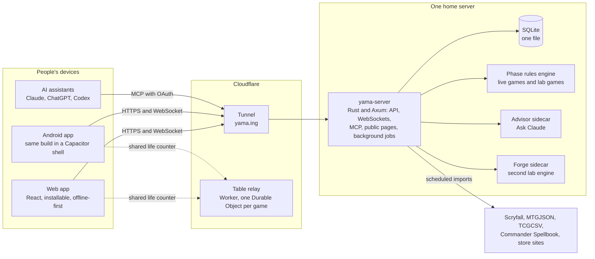

# Yama

Yet Another Magic App: a free companion for Magic: The Gathering Commander players. It runs at
**[yama.ing](https://yama.ing)** in the browser, installs to a phone's home screen, and keeps
working at a table with bad wifi.

- **Unofficial fan software.** Not affiliated with, endorsed by, or sponsored by Wizards of the
  Coast. Card data and images come from [Scryfall](https://scryfall.com); images load from
  Scryfall at runtime and are never stored or re-hosted here.
- **Source-available, not open source.** The code is public to read. [LICENSE](LICENSE) reserves
  all rights; see [Licence and credits](#licence-and-credits).

## What it does

| Area | In short |
|---|---|
| Game night | A life counter for 1 to 6 players with commander damage, poison and counters. Every phone at the table can join one shared game by QR code. It works offline and syncs later. |
| Playgroups | Game history and stats for a group of friends, with guests who have no account: win rates by player, commander and turn order, each shown with its game count. |
| Cards | Scryfall-style search that works offline, rulings, printings, dated prices with history, a release calendar and a camera scanner. |
| Collection | Binders, boxes and deck boxes, real copies and proxies, with lossless Mythic Tools import and export. |
| Decks | Paste any common list format, keep versions, see what you own and what you still need, sample hands, mana stats, a bracket estimate, and plans for upgrading a deck. |
| Online play (alpha) | Commander against friends or AI on the [Phase](https://github.com/bryanroscoe/yama-phase) rules engine. The server keeps hidden information hidden and saves every game as a replay. |
| Lab | AI-against-AI tournaments to try a deck change, on Phase and on Forge, read as paired differences with intervals. |
| Public reference | [Precons](https://yama.ing/precons) and [commanders](https://yama.ing/commanders) for anyone, without signing in: stock lists, attributed real-game results and dated prices. |
| Assistants | An [MCP server](https://yama.ing/docs/mcp/) so Claude, ChatGPT or Codex can read your decks and collection and stage changes for you to approve. |

Personal data stays private to its account unless the owner shares it by link or on a public
profile. The full list, area by area, is in [docs/features.md](docs/features.md).

## How it fits together

One Rust server and one SQLite file do nearly everything. The pieces around them exist for
isolation (untrusted or heavy work runs in its own process or container) or for independence
(the shared life counter keeps working when the server is down).



- **Clients.** One React and TypeScript app serves the browser, the installed web app and the
  Android shell. Writes made offline are queued as operations with client-made IDs and applied
  once by the server, so a retry is always safe.
- **Server.** `yama-server` is a single Rust binary: the JSON API, WebSockets for live games,
  the MCP endpoint with its OAuth server, server-rendered public pages, the built web app's
  files, and the scheduled card, price and calendar imports.
- **Rules engines.** Online games run on a pinned fork of Phase inside the server, which checks
  every action against the engine's legal list and sends each seat only what that seat may see.
  Lab games run in isolated child processes, and optionally on Forge in its own container with
  no network access.
- **Shared table.** Phones at a table meet on a Cloudflare Worker, not on the home server, so
  game night survives a server or internet outage at home.
- **Delivery.** Every change lands through a reviewed pull request. CI runs on GitHub-hosted
  runners, and a green `main` deploys itself through a gate on the server that checks the
  commit and its CI run again before it switches anything.

[ARCHITECTURE.md](ARCHITECTURE.md) has the full picture: more diagrams, how each flow works, and
the dated record of every design decision.

## Repository layout

| Path | What lives there |
|---|---|
| `server/` | The Rust server (Axum, sqlx on SQLite) and its command-line tools: imports, invites, account and price commands. Schema in `server/migrations/`. |
| `play/` | Online play and the Lab's game core on top of the Phase engine, with the `soak`, `playbench`, `lab`, `coverage` and `referee` binaries. |
| `web/` | The React app (Vite), its service worker, the offline card store, the scanner, and the Android project in `web/android/`. |
| `packages/core/` | Shared TypeScript with no UI: the life counter reducer, offline card search, deck lists and stats, sample hands, and the planner's logic. |
| `relay/` | The shared table's Cloudflare Worker and Durable Object. |
| `advisor/` | The Ask Claude sidecar (Node, Claude Agent SDK). |
| `forge-worker/` | The HTTP front that runs Forge as a second Lab engine. Forge itself is not in this repository. |
| `referee/` | Scripted rules scenarios run in both Phase and Forge, to find where the engines disagree. |
| `runtime/` | The frozen engine build that reopens games saved before an engine upgrade. |
| `tools/`, `scripts/` | Lab workers and benchmarks; local CI, release trains, dataset and research helpers. |
| `extension/mpc/` | A Chrome extension that fills a MakePlayingCards order from a plan's print list. |
| `plugins/yama/` | The Codex and ChatGPT plugin that packages the MCP connection with skills. |
| `deploy/` | Dockerfiles, the Compose file, the release gate and the runbooks. |
| `design/` | The "Night table" design system: tokens, logo and screen sources. |
| `docs/` | Design notes, formats, runbooks and dated reports. Start at [docs/README.md](docs/README.md). |
| `data/` | The local SQLite database and downloads (git-ignored). |

The rules engine is maintained in its own repository,
[bryanroscoe/yama-phase](https://github.com/bryanroscoe/yama-phase) (MIT or Apache-2.0, a fork of
[phase-rs](https://github.com/phase-rs/phase)). `deploy/phase-rev` pins the exact commit Yama
builds against.

## Run it locally

Running Yama needs the permission described in [LICENSE](LICENSE). You also need Rust (stable,
2024 edition; CI uses 1.98.1), Node 22 or newer, and the engine checked out beside this
repository at the pinned commit, because the Cargo workspace builds against it:

```sh
git clone https://github.com/bryanroscoe/yama-phase.git ../yama-phase
git -C ../yama-phase checkout "$(cat deploy/phase-rev)"
```

Then, from an empty database:

```sh
cp .env.example .env                         # set YAMA_ADMIN_EMAILS to your email; keep YAMA_DEV_LOGIN=1
cargo build -p yama-server
./target/debug/yama-server import-cards      # about 2 minutes: Scryfall bulk data and rulings (~110 MB, deleted after)
./target/debug/yama-server serve             # API on http://127.0.0.1:8787

npm install
npm run dev                                  # web app on http://localhost:5173, proxying /api
```

Open `http://localhost:5173` and sign in with the development login (any email, no password).
[`.env.example`](.env.example) lists every setting, and
[docs/development.md](docs/development.md) covers the rest: the server's other commands (imports,
invites, accounts), debugging with real data, and the full-game checks.

To serve the built web app from the Rust server, as production does: `npm run build`, then
`YAMA_WEB_DIST=web/dist ./target/debug/yama-server serve`.

### Signing in

Google sign-in only works on origins added to an OAuth client, so locally use one of these:

- **Development login** (`YAMA_DEV_LOGIN=1`): any email, no password. Handy for playing as
  several people in different browsers. It works only while the server listens on localhost.
- **Password accounts:** `./target/debug/yama-server user add you@example.com --admin` prints a
  generated password, and the sign-in page then offers "Sign in with a password". No route in
  the app creates one, and `YAMA_PASSWORD_LOGIN=0` turns them off
  ([more](docs/development.md#signing-in)).
- **Google:** create an OAuth client ID of type "Web application" in Google Cloud Console, add
  your origin (for example `http://localhost:5173`) to its authorized JavaScript origins, and
  set `YAMA_GOOGLE_CLIENT_IDS`. The Android app uses the same web client ID
  ([docs/mobile.md](docs/mobile.md)).

### Online play and the Lab

Both need the engine's card data file in `data/engine/`, built to match `deploy/phase-rev`. It
is not published for download; [docs/engine-integration.md](docs/engine-integration.md) explains
how to build it. `./target/debug/soak` then plays an all-AI game and checks that its replay is
deterministic.

### With a copy of production's data (maintainers)

`npm run local` copies the newest production backup, starts the server and the web app with
every outbound and background job off, and prints how to sign in. It needs SSH access to the
production host, and the copy holds real people's data: never commit, upload or paste it, and
delete it when done. See
[.claude/skills/yama-local/SKILL.md](.claude/skills/yama-local/SKILL.md). `npm run polish` takes
screenshots of every page at three sizes ([docs/polish.md](docs/polish.md)).

## Checks

```sh
cargo test            # server and play
npm test              # TypeScript unit tests: packages/core, web, relay
npm run typecheck     # packages/core and web
npm run build         # production web build
```

`scripts/local-ci.sh --no-amend` runs everything CI runs, on the current commit.
[GitHub CI](docs/ci.md) runs the same checks on GitHub-hosted runners for every ready pull
request into `main` and every push to `main`.

`cargo test` skips the full-game tests. Those, with the determinism, performance and per-card
coverage checks, are in [docs/development.md](docs/development.md#full-game-checks) and
[docs/gameplay-validation.md](docs/gameplay-validation.md).

## Releases

Merging to `main` is a release. Once CI passes on that commit, a GitHub-hosted job asks the
production host to deploy it over Cloudflare Access; the host verifies the commit and its CI run
itself, backs up the database, builds the images, and switches over only when every health check
passes. See [deploy/RELEASING.md](deploy/RELEASING.md), [deploy/RUNNER.md](deploy/RUNNER.md) and
[deploy/README.md](deploy/README.md).

## Documentation

- [docs/features.md](docs/features.md): what works today, area by area.
- [ARCHITECTURE.md](ARCHITECTURE.md): how Yama is built, with diagrams, and the decision record.
- [docs/README.md](docs/README.md): an index of every design note, format, runbook and report.
- [MCP feature and setup guide](https://yama.ing/docs/mcp/): connecting an assistant.
- [AGENTS.md](AGENTS.md): the working rules for the coding agents that build Yama.
- [SECURITY.md](SECURITY.md): how to report a vulnerability.

## Licence and credits

Copyright © 2026 Bryan Roscoe. The source is public to read, not to reuse: [LICENSE](LICENSE)
reserves all rights, and people Bryan names get written permission. [COPYRIGHT](COPYRIGHT) covers
what that does and does not claim.

Third-party work keeps its own terms. The Phase engine is MIT or Apache-2.0.
[Forge](https://github.com/Card-Forge/forge) is GPL-3.0; Yama runs it as a separate program and
includes none of its code. Card data and images are Scryfall's. Prices come from Scryfall,
[MTGJSON](https://mtgjson.com) and TCGCSV, each shown with its date and source. Magic: The
Gathering is a trademark of Wizards of the Coast LLC.
